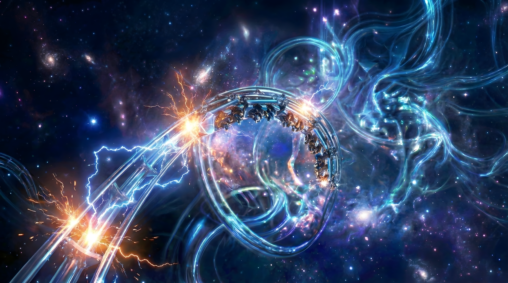

# Coaster

An [Omarchy](https://omarchy.org/) theme built around a sci-fi wallpaper of
glowing energy rings and lightning arcing across a starfield. Deep navy
backgrounds, vivid electric-blue and cyan accents, and warm orange/red spark
highlights for contrast.



## Install

```bash
omarchy theme install https://github.com/londospark/omarchy-coaster-theme.git
omarchy theme set coaster
```

## Files

- `colors.toml` — the palette; everything else (terminal configs, Hyprland,
  Neovim, btop, VS Code, etc.) is generated from this by Omarchy's theme
  templates.
- `backgrounds/coaster.png` — the wallpaper, AI-upscaled to 5120×2858.
- `icons.theme` — `Yaru-blue`
- `keyboard.rgb` — accent-matched keyboard backlight color
